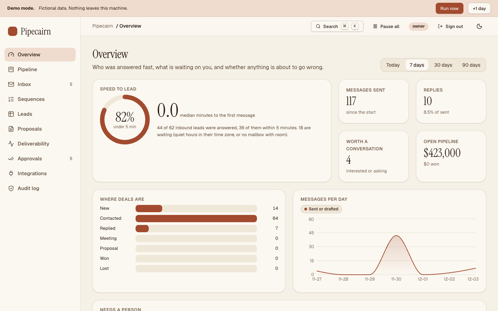
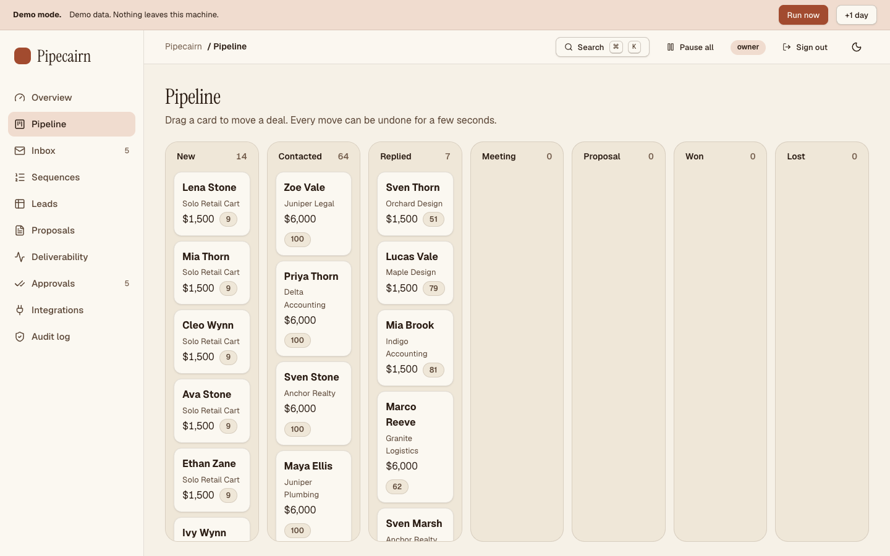
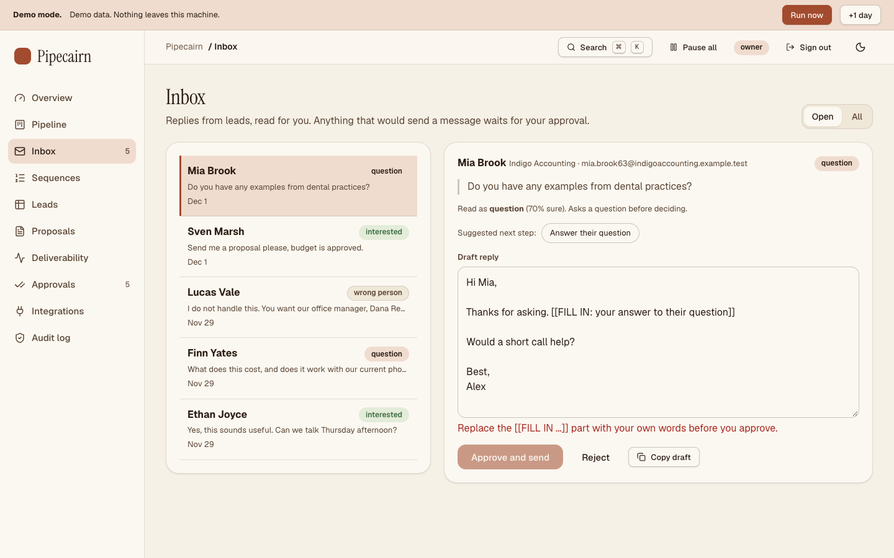

# Pipecairn

Pipecairn answers new leads fast, follows up politely, books calls, and gets a proposal to a signature. It starts in a safe draft mode where nothing is sent, so you can try it on invented data in about 10 minutes.

## What it does

- Takes in leads, merges duplicates, flags bad addresses, scores fit.
- Sends a sequence of emails and texts through a chain of safety checks (stop lists, quiet hours, mailbox caps, consent), and only in live mode.
- Reads replies and sorts them: interested, question, not now, wrong person, unsubscribe, out of office, bounce.
- Suggests a reply for a person to approve, books a call, writes a proposal and contract as PDFs, and prepares them for signature.
- Keeps a tamper evident audit log and has a kill switch.

| Pipeline | Inbox |
|---|---|
|  |  |

## Try it

Follow [docs/01-QUICK-DEMO.md](docs/01-QUICK-DEMO.md). Everything in the demo is fictional and nothing leaves your computer. The demo password only works while `DEMO_MODE=true`.

## Use it for real

Start at [docs/00-START-HERE.md](docs/00-START-HERE.md). The guides run from `00` to `15`: business basics, connecting tools, settings, running locally, deploying (Vercel, Railway, Hetzner), a go live checklist, operating, updating, security, limits and troubleshooting. Reference: [architecture](docs/ARCHITECTURE.md), [capabilities](docs/CAPABILITIES.md), [tools and alternatives](docs/TOOLS-AND-ALTERNATIVES.md), [reply reader evaluation](docs/REPLY-READER-EVAL.md), [glossary](docs/GLOSSARY.md), [facts and sources](docs/FACTS-AND-SOURCES.md).

## What was measured

- <!--n:tests.passed-->462<!--/n--> Python tests passed, <!--n:tests.skipped-->1<!--/n--> skipped (needs a Postgres), <!--n:tests.coverage_percent-->92<!--/n--> percent line coverage of the `pipecairn` package, plus <!--n:web_unit_tests-->11<!--/n--> unit tests of the web app helpers (the CSV reader, the forwarded address and the sign in path guard of the web proxy). Numbers come from `data/measured.json`.
- Database migrations up, down and up again on SQLite and Postgres 17.7. A hand run of the demo on Postgres (reset, send, replies read, audit chain verified) also worked; that was a manual check, not an automated test.
- A fresh clone in a temporary folder was installed from nothing, built, tested and run through the browser tests, then deleted.
- <!--n:browser_tests-->40<!--/n--> browser tests passed, three full runs in a row (including the CSV file upload and opening a pipeline card), including accessibility scans of 10 pages in light and dark (0 serious or critical problems).
- The seed check (`python tools/score_seed.py`): 29 planted must not send addresses, none written to.
- The offline reply reader is a set of rules, not a language model. On <!--n:reader.set_b_first.total-->170<!--/n--> replies written by someone who never saw the code (independent set B, run once) it read **<!--n:reader.set_b_first.strict-->114<!--/n--> exactly as the key says (<!--n:reader.set_b_first.strict_percent-->67.1<!--/n--> percent)**, <!--n:reader.set_b_first.lenient-->121<!--/n--> if the key's alternative answers count, and missed <!--n:reader.set_b_first.stops_missed-->7<!--/n--> of <!--n:reader.set_b_first.clear_stops-->34<!--/n--> clear requests to stop (a miss still stops the follow ups). Set A, run before the reader was improved, gave <!--n:reader.set_a_first.strict_percent-->59.2<!--/n--> percent. The older self written sets are no longer held out. A live model path exists (`LLM_BACKEND=anthropic`) and was never run with a real key: UNVERIFIED. Details: `docs/REPLY-READER-EVAL.md`.

## Honest limits

No adapter has been run against a real service. The reply reader is an offline stand-in made of rules, not a language model. You must register business texting with carriers and set up your own sending domains yourself. The Docker images are built and started by the GitHub CI workflow, but no real host (Vercel, Railway, Hetzner) was deployed to. Read [docs/14-LIMITS-AND-HONEST-NOTES.md](docs/14-LIMITS-AND-HONEST-NOTES.md) before real use.

## Layout

`apps/api` API and worker, `apps/web` dashboard, `mock` fake vendor servers, `data` demo data, `tools` helper commands, `docs` guides, `packages` shared frozen base, `deploy` hosting files, `prompts` and `templates` for Claude Code and Codex.

## Licence

MIT. See [LICENSE](LICENSE).
