# What Pipecairn does (with pictures)

All screens show fictional demo data. Desktop and phone versions of each are in `docs/screenshots/`.

## Overview: speed to lead and the funnel
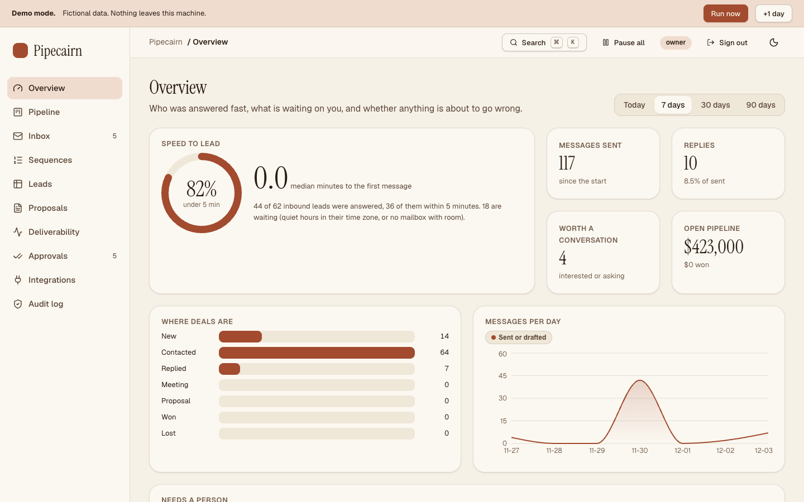

## Pipeline: deals by stage, drag to move
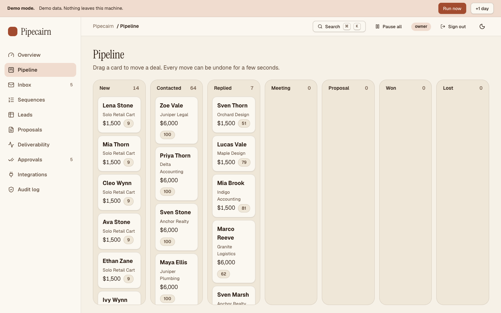

## Inbox: replies sorted, with a suggested answer to approve
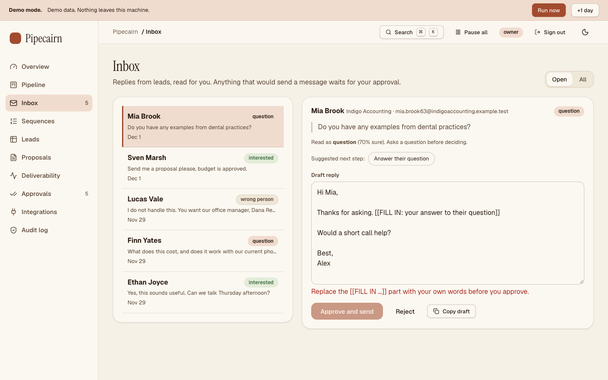

## Sequences: edit steps and preview exactly what a lead receives
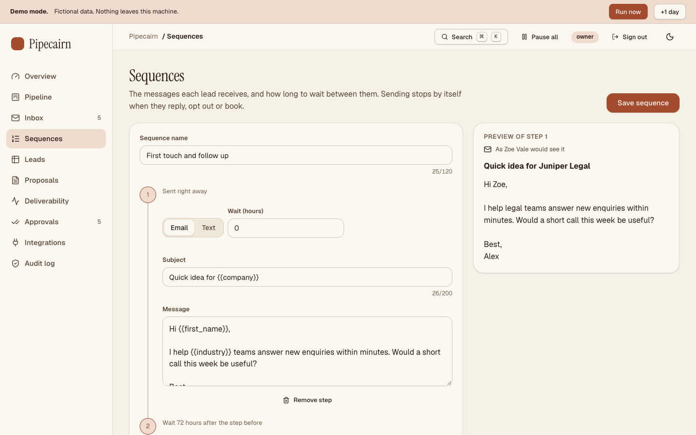

## Lead sheet: everything about one person
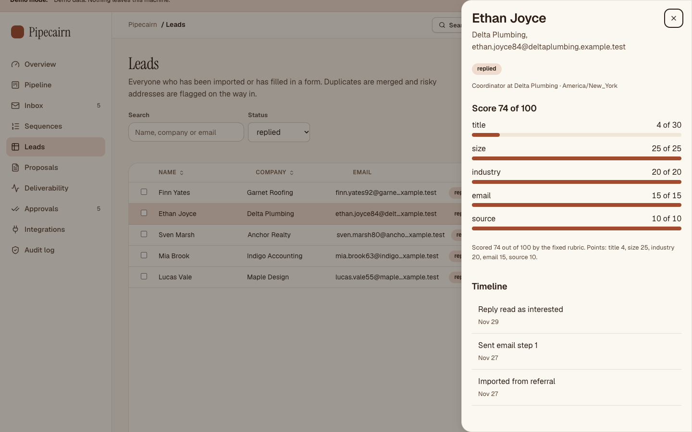

## Import: choose a CSV file, check the preview, then import
The Leads page has an Import CSV button. In the dialog, press "Choose a CSV file" (it is a real file input, so the keyboard works) or paste the text. The browser reads the file on your machine, shows the row count, the column count and a preview of the first rows, and warns before you press Import if the file has no data rows or no email column. Nothing is sent until you press Import. Files over 2 MB are refused with a plain message. Tested with a browser test that uploads a small fixture file and finds the new leads in the table.

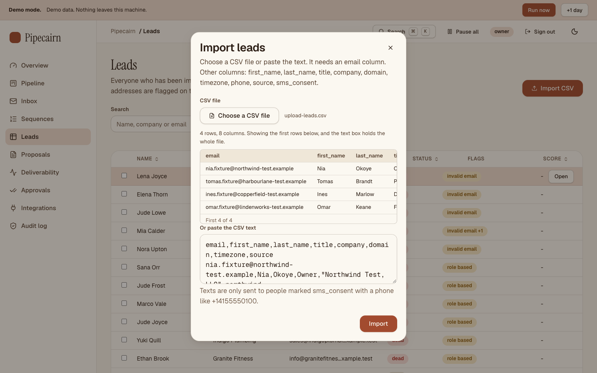

## Proposals: build text, make the PDF, prepare for signature
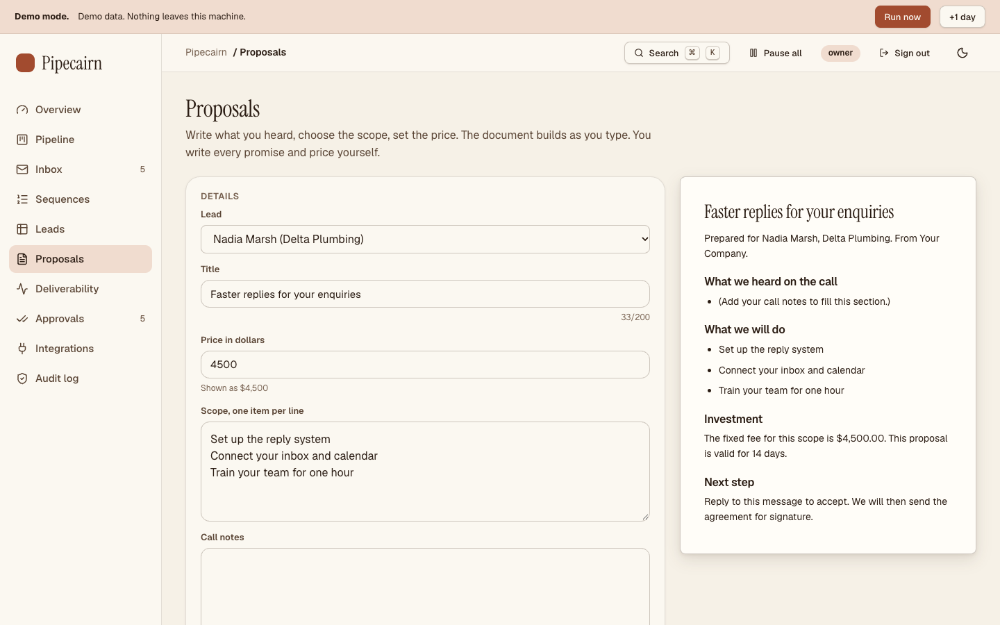

## Deliverability: a paused mailbox, caps and bounce rates
The owner now also sees an "Add a sending mailbox" card above the mailboxes (added in 1.0.1). The screenshot below was taken before it existed.

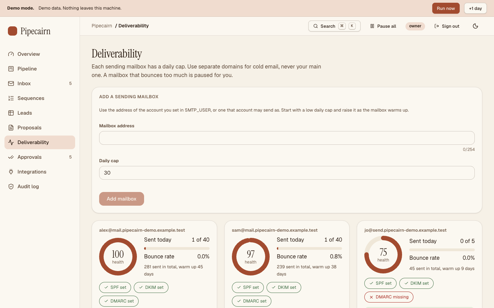

## Approvals and audit
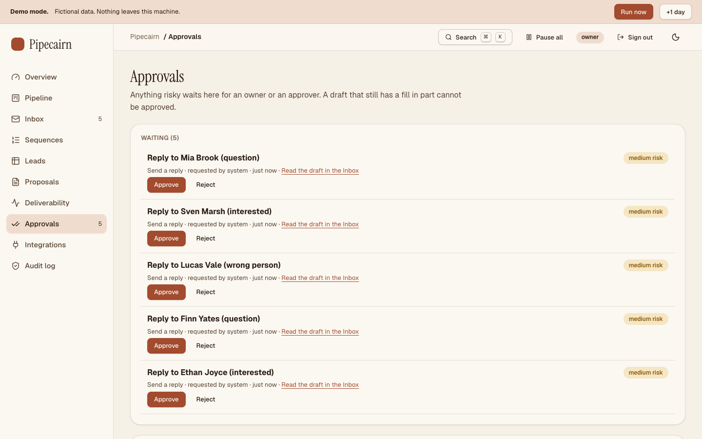
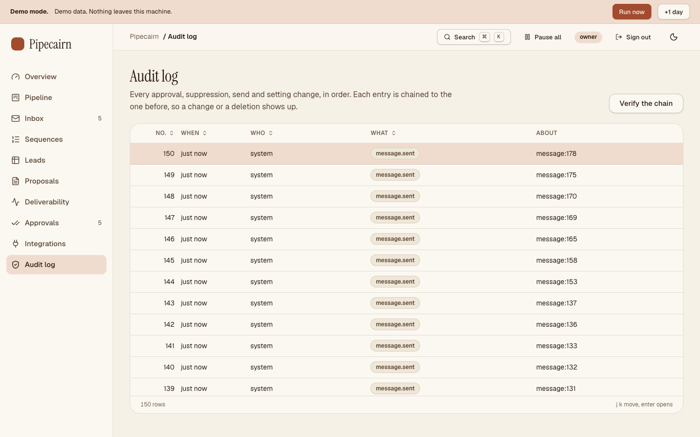

## Integrations: what is selected, what it needs, test button
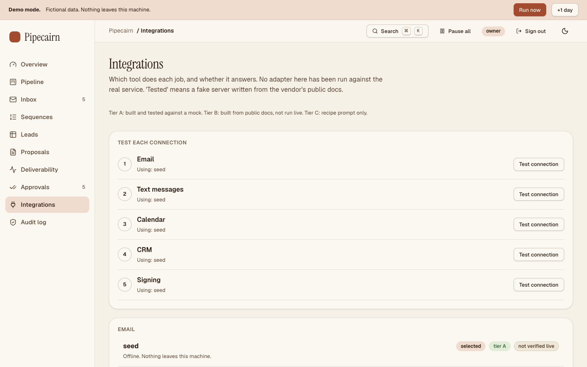

## States and themes
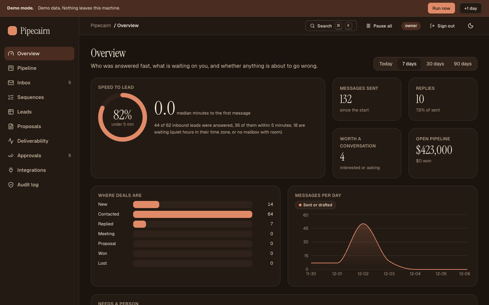
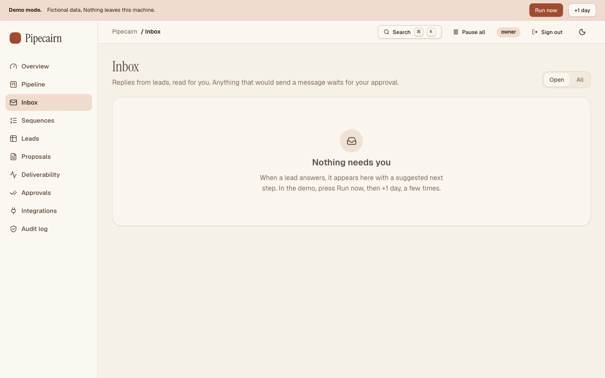
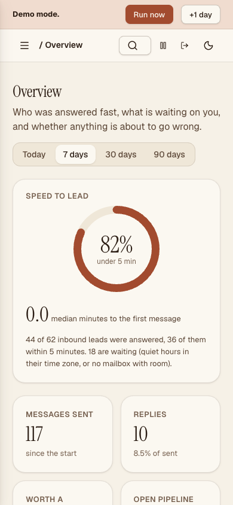

## Capability list (measured)

| Capability | How it was checked |
|---|---|
| Never contacts the 29 planted must not send addresses | `tools/score_seed.py`, 29 of 29, plus 6 randomised property worlds in the test suite |
| Merges 10 duplicate pairs, flags 6 role based, 5 invalid emails, 3 bad time zones, 5 bad phones, 8 customer leads | `tools/score_seed.py` |
| Scores perfect fit leads at 70 or more and poor fit at 30 or less | 12 of 12 each, on the demo data, where industry and size are filled in. Real imports score the same way only when the CSV has `industry` and `size` columns (without them the most a lead can score is 55) |
| Pauses a bouncing mailbox, honours a mailbox cap | tests and seed check |
| Sorts invented replies | Offline stand in (rules, not a model): **<!--n:reader.set_b_first.strict-->114<!--/n--> of <!--n:reader.set_b_first.total-->170<!--/n--> (<!--n:reader.set_b_first.strict_percent-->67.1<!--/n--> percent) on independent set B**, run once. A live model path exists and is UNVERIFIED. See `REPLY-READER-EVAL.md` |
| Dashboard works on desktop and phone, keyboard, light and dark, reduced motion | <!--n:browser_tests-->40<!--/n--> browser tests; accessibility scan of 10 pages in 2 themes found 0 serious or critical problems |
| 5,000 row table stays smooth | layout shift under 0.1 (desktop) |
| A real (not demo) install can add a mailbox and a sequence, mark customers, import a do not contact list, import leads and send one draft | `apps/api/tests/test_hardening_install.py` (a fresh database, through the API) |
| Every email has a footer (company, address, stop line) and `List-Unsubscribe` headers; texts get a stop line | `test_hardening_mail.py` |
| A forged "mail delivery failed" cannot suppress a lead or pause a mailbox; a real stop request still acts at once | `test_hardening_mail.py` |
| The in app kill switch and force draft stop CRM writes even with `MODE=live` | `test_hardening_ops.py` |
